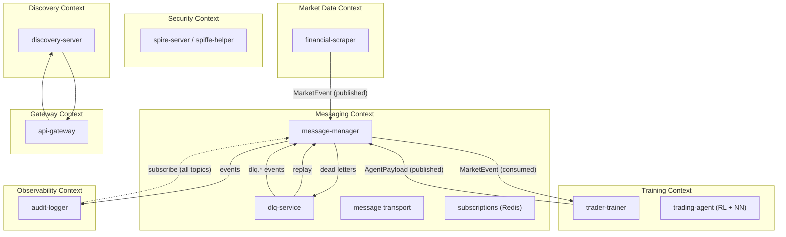

# Bounded Contexts — trading-model

This document defines the Domain-Driven Design (DDD) bounded contexts for the trading-model platform.

## Context Map

## Contexts Defined

### 1. Market Data Context

- **Owner:** `financial-scraper`
- **Core entities:** Candle, Trade, Ticker, OrderBook
- **External dependency:** Binance API
- **Publishes:** `market.trade.recent.fetch`, `market.candlestick.series.fetch`, `market.order-book.snapshot.fetch`, `market.ticker.24hr-stats.fetch`, `market.price-ticker.snapshot.fetch`, `market.order-book-ticker.snapshot.fetch`
- **Debug events:** `example.debug.create`, `example.show.create`

### 2. Training Context

- **Owner:** `trader-trainer`
- **Sub-contexts:** `genetic-algorithm` (population evolution), `neural-network` (agent learning)
- **Core entities:** Genome, Agent, Wallet, Experience
- **Consumes:** Market events from Market Data Context
- **Publishes:** Agent payloads (best agent after each generation)

### 3. Messaging Context

- **Owner:** `message-manager` + `dlq-service` (dead letters and replay are part of delivery, not observability)
- **Core entities:** Message, Subscription, DeliveryAttempt, DeadLetterEntry
- **Responsibilities:** Topic routing, delivery guarantees, retry (message-manager); dead-letter storage and replay back to message-manager (dlq-service). The broker stores no message (ADR-0019)
- **Internal interfaces:** `MessageDeliveryPort`, `SubscriptionStorePort`
- **Publishes (dlq-service):** `dlq.entry.added`, `dlq.replay.completed`, `dlq.entries.deleted`

### 4. Security Context

- **Owner:** SPIFFE/SPIRE (ADR-0011) — `spire-server`, `spire-agent`, `spiffe-helper` sidecars
- **Core entities:** SVID, Registration Entry, Trust Bundle
- **Responsibilities:** Workload attestation, X.509 SVID issuance/rotation, SPIFFE identity

### 5. Discovery Context

- **Owner:** `discovery-server`
- **Core entities:** ServiceInstance, Lease
- **Responsibilities:** Registration, heartbeat, token management

### 6. Observability Context

- **Owner:** `audit-logger`
- **Core entities:** AuditEvent
- **Consumes:** All published events for audit trail (including `dlq.*`)
- **Internal events:** `audit.heartbeat`, `audit.gap.detected`

### 7. Gateway Context

- **Owner:** `api-gateway`
- **Core entities:** Route, CacheEntry
- **Responsibilities:** Auth, rate limiting, caching, proxying

## Integration Patterns

| Relationship           | Pattern              | Implementation                        |
| ---------------------- | -------------------- | ------------------------------------- |
| Market Data → Training | Pub/Sub (async)      | Message Manager topics                |
| Any → Audit            | Pub/Sub (async)      | Audit-logger subscribes to all topics |
| Services → Discovery   | Request/Reply (sync) | HTTPS mTLS                            |
| Services → Security    | Request/Reply (sync) | SPIFFE/SPIRE workload attestation + Workload API |
| External → Platform    | Proxy (sync)         | API Gateway                           |

## Event Enum Evolution

The historical single `EnumEventMessage` enum (mixing market data, certificate, and audit topics) has been split into per-context enums:

1. `MarketEvent` — `@trading-model/contracts/market-events`
2. `AuditEvent` — `@trading-model/contracts/audit-events`
3. `TrainingEvent` — `@trading-model/contracts/training-events`
4. `DlqEvent` — `@trading-model/contracts/dlq-events`: dlq-service publishes `dlq.entry.added`, `dlq.replay.completed` and `dlq.entries.deleted` so the audit trail records what happens to undelivered messages
5. Certificate/security events were **removed** with the CA decommission (ADR-0011)

Per-context Zod schemas live in `@trading-model/broker-message/domain/messages/schemas` (metadata, message payload, market events, audit events).
