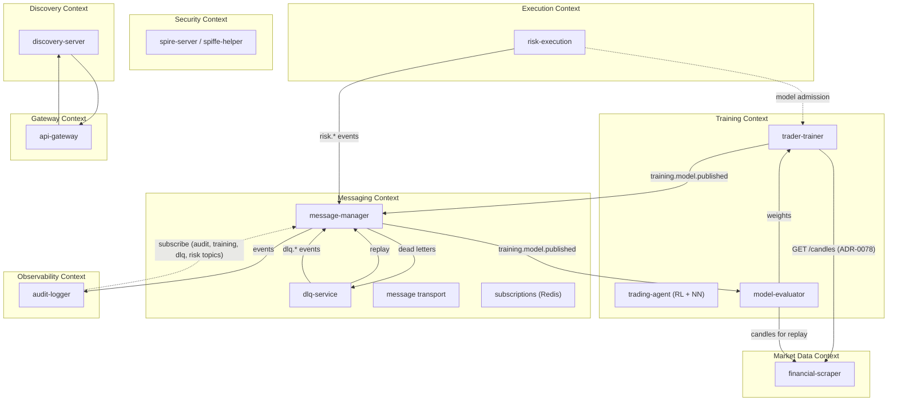

# Bounded Contexts — trading-model

This document defines the Domain-Driven Design (DDD) bounded contexts for the trading-model platform.

## Context Map

## Contexts Defined

### 1. Market Data Context

- **Owner:** `financial-scraper`
- **Core entities:** Candle, Trade, Ticker, OrderBook
- **External dependency:** Binance API
- **Publishes:** nothing since ADR-0078: the trainer reads candles through the scraper API.
- **Signals (ADR-0036):** collected and served at `GET /financial-scraper/signals/assets/:assetId`; read by trader-trainer, and fed to the network only when `FEATURE_SIGNAL_INPUTS` is on (default off, ADR-0081, input mask ADR-0082).

### 2. Training Context

- **Owner:** `trader-trainer`
- **Sub-contexts:** `genetic-algorithm` (population evolution), `neural-network` (agent learning)
- **Core entities:** Genome, Agent, Wallet, Experience
- **Consumes:** no topic; reads the stored candle window from `GET /candles/symbols/:symbol` at each session (ADR-0078)
- **Publishes:** `training.model.published` after each versioned artifact (ADR-0022)
- **Consumers:** audit-logger (chain) and `model-evaluator`, the offline evaluation consumer (ADR-0049 option B): it is the only entry of `MODEL_DOWNLOAD_CALLERS`, verifies the weights against the manifest, replays the model on the stored candles of its manifest window (ADR-0079) and records one evaluation per `(symbol, version)`. `decision-consumer` is the paper decision consumer (ADR-0049 option C, [ADR-0087](../adr/0087-paper-decision-consumer.md)): it also lists in `MODEL_DOWNLOAD_CALLERS`, decides only with the models of `PROMOTED_MODELS` that are `admissible`, and sends their intents to `risk-execution`.

### 3. Messaging Context

- **Owner:** `message-manager` + `dlq-service` (dead letters and replay are part of delivery, not observability)
- **Core entities:** Message, Subscription, DeliveryAttempt, DeadLetterEntry
- **Responsibilities:** Topic routing, delivery guarantees, retry (message-manager); dead-letter storage and replay back to message-manager (dlq-service). Accepted messages stay in the Redis Streams journal until delivery; during ADR-0073 release N the bus library and message-manager share that journal
- **Internal interfaces:** `MessageDeliveryPort`, `SubscriptionStorePort`
- **Publishes (dlq-service):** `dlq.entry.added`, `dlq.replay.completed`, `dlq.entries.deleted`

### 4. Security Context

- **Owner:** SPIFFE/SPIRE (ADR-0011) — `spire-server`, `spire-agent`, `spiffe-helper` sidecars
- **Core entities:** SVID, Registration Entry, Trust Bundle
- **Responsibilities:** Workload attestation, X.509 SVID issuance/rotation, SPIFFE identity

### 5. Discovery Context

- **Owner:** `discovery-server`
- **Core entities:** ServiceInstance, Lease
- **Responsibilities:** Registration, heartbeat, token management

### 6. Observability Context

- **Owner:** `audit-logger`
- **Core entities:** AuditEvent
- **Consumes:** audit, training, dlq and risk topics (market data is not chained)
- **Internal events:** `audit.heartbeat`, `audit.gap.detected`

### 7. Gateway Context

- **Owner:** `api-gateway`
- **Core entities:** Route, CacheEntry
- **Responsibilities:** Auth, rate limiting, caching, proxying

### 8. Execution Context

- **Owner:** `risk-execution` ([ADR-0064](../adr/0064-risk-and-execution-context-before-order-flow.md)), separate from the model and from the decision consumer
- **Core entities:** Intent, Order, Position, KillSwitch
- **Responsibilities:** pre-trade checks, order lifecycle, kill switch, reconciliation; paper only (simulated broker, no live adapter)
- **Consumes:** intents over HTTP (`POST /intents`), only `decision-consumer` sends them ([ADR-0049](../adr/0049-downstream-context-for-models-and-signals.md), [ADR-0087](../adr/0087-paper-decision-consumer.md)); the last closed candle of each instrument from financial-scraper (`SCRAPER_API.candlesLatest`)
- **Publishes:** `risk.*` events (order transitions, kill switch), chained by audit-logger

## Integration Patterns

| Relationship           | Pattern              | Implementation                        |
| ---------------------- | -------------------- | ------------------------------------- |
| Market Data → Training | Request/Reply (sync) | Candle read route of financial-scraper (ADR-0078) |
| Any → Audit            | Pub/Sub (async)      | Audit-logger subscribes to audit, training, dlq and risk topics |
| Services → Discovery   | Request/Reply (sync) | HTTPS mTLS                            |
| Services → Security    | Request/Reply (sync) | SPIFFE/SPIRE workload attestation + Workload API |
| External → Platform    | Proxy (sync)         | API Gateway                           |

## Event Enum Evolution

The historical single `EnumEventMessage` enum (mixing market data, certificate, and audit topics) has been split into per-context enums:

1. `AuditEvent` — `@trading-model/contracts/audit-events`
2. `TrainingEvent` — `@trading-model/contracts/training-events`
3. `DlqEvent` — `@trading-model/contracts/dlq-events`: dlq-service publishes `dlq.entry.added`, `dlq.replay.completed` and `dlq.entries.deleted` so the audit trail records what happens to undelivered messages
5. Certificate/security events were **removed** with the CA decommission (ADR-0011)

Per-context Zod schemas live in `@trading-model/broker-message/messages/schemas` (metadata, message payload, market events, audit events).
