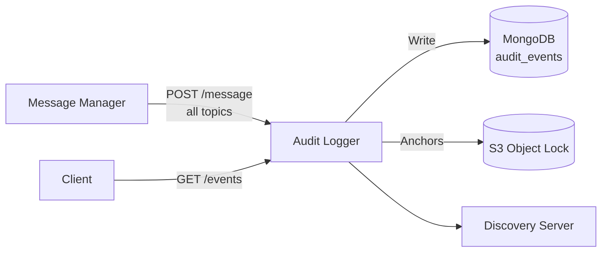

# Architecture — Audit Logger

## Overview

The Audit Logger provides immutable traceability for all platform events. It subscribes to every topic on the message bus, persists each event to MongoDB, and exposes a queryable REST API with pagination, filtering, and aggregate statistics.

## System Context



## Project Structure

```
services/audit-logger/
├── src/
│   ├── domain/                   # Pure: audit chain, date range
│   │   └── ports/                # Audit chain ports
│   ├── application/
│   │   ├── index.ts              # Entry point: bootstrap, MongoDB connect, broker subscription
│   │   ├── server.ts             # Express server factory
│   │   ├── chain-cli.ts          # Operator CLI (package.json bin "audit-chain", ADR-0027)
│   │   └── audit-chain/          # Chain verification + anchoring scheduler
│   ├── adapters/
│   │   ├── inbound/
│   │   │   ├── http/             # Controllers, routes, query-param parsing
│   │   │   └── subscription/     # Bus → repository ingestion, message parsing
│   │   └── outbound/
│   │       ├── persistence/      # MongoDB repositories (audit events, chain state), filters, stats
│   │       └── anchor/           # S3 anchor store
│   ├── infrastructure/
│   │   └── config/env.ts         # Zod-validated environment
│   └── config/
│       ├── container.ts          # Composition root: Mongo repositories, chain audit, message handler,
│       │                         # server — createAuditLoggerApp()
│       ├── broker-setup.ts       # Message bus subscription wiring
│       ├── metrics.ts            # Prometheus collectors
│       └── address-manager.ts
├── tests/
├── Dockerfile
├── package.json
└── tsconfig.json
```

## Layer Architecture

```
Message Bus (all topics)
    │
    ▼
BrokerMessage SDK ──→ onMessage handler
    │
    ▼
AuditRepository ──→ MongoDB (audit_events collection)
    │
    ▼
REST API (GET /events, GET /events/stats, GET /events/:id)
```

## Key Design Decisions

- **Subscribes to ALL bus topics** — ensures no event is missed for audit purposes
- **MongoDB time-series friendly** — `audit_events` collection uses date-based indexing
- **Retention** — configurable via `AUDIT_RETENTION_DAYS` (default 90 days)
- **No job scheduler** — the job queue and WebSocket worker protocol had no producer and no worker; removed by ADR-0029
