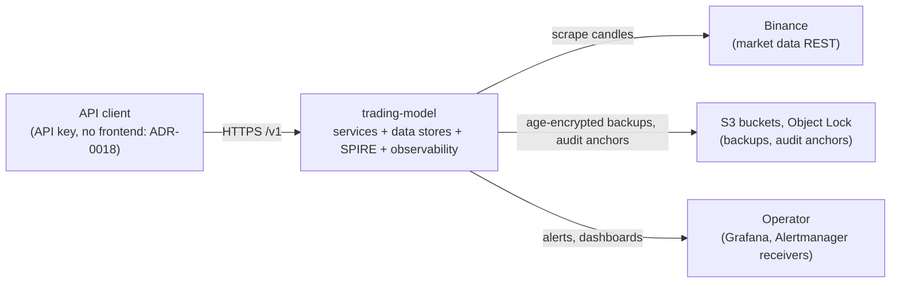
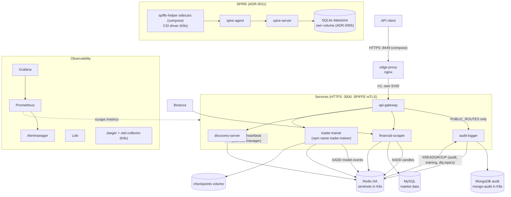
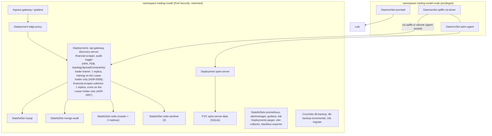
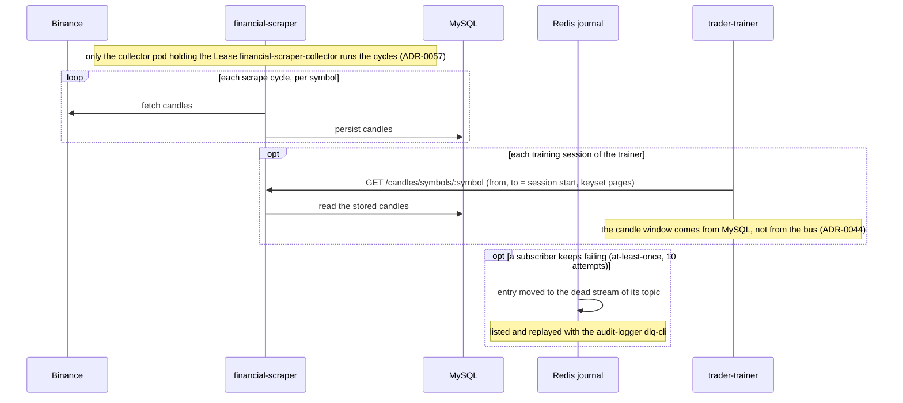

# System Overview (C4)

Four views of the system, each node checkable in `docker-compose.yml`, `deploy/k8s/` or the code. Related: [ADR-0011](../adr/0011-spiffe-spire-workload-identity.md) (SPIRE), [ADR-0073](../adr/0073-message-bus-as-a-redis-streams-library.md) (bus), [ADR-0023](../adr/0023-discovery-registry-in-redis.md) (registry, being retired by [ADR-0072](../adr/0072-dns-routing-and-majors-served-by-services.md)), [Databases](databases.md), [Bounded Contexts](bounded-contexts.md).

> **Paper only.** Trained models (`training.model.published`, weights route open to `model-evaluator` alone through `MODEL_DOWNLOAD_CALLERS`) are verified and replayed on stored candles by the offline `model-evaluator` ([ADR-0079](../adr/0079-replay-window-in-the-model-manifest.md)). Collected signals (`GET /financial-scraper/signals/assets/:assetId`) enter the network only when `FEATURE_SIGNAL_INPUTS` is on (default off, [ADR-0081](../adr/0081-signal-inputs-to-the-network.md), mask [ADR-0082](../adr/0082-input-mask-gene.md)). `risk-execution` owns every order, paper only (simulated broker, kill switch, [ADR-0064](../adr/0064-risk-and-execution-context-before-order-flow.md)): it takes intents over HTTP (`POST /intents`), only from `decision-consumer` ([ADR-0087](../adr/0087-paper-decision-consumer.md): promoted models, decision on each closed bar), and reads its prices from financial-scraper. See [ADR-0049](../adr/0049-downstream-context-for-models-and-signals.md).

## 1. C4 level 1 — Context

## 2. C4 level 2 — Containers

The bus is a library linked in each service (ADR-0073): the durable message journal and the dead streams are Redis Streams (ADR-0048), consumed in process, with no broker service in between. MongoDB belongs to audit-logger: compose runs one `mongo` container (database `audit-logger`); K8s runs one StatefulSet, `mongo-audit`.

## 3. Kubernetes deployment

The restricted namespace forbids `hostPath`, so every host-level agent lives in `trading-model-node` (see `deploy/k8s/node-agents`).

## 4. Market data flow

The trainer subscribes to no topic: its candle window is read from financial-scraper at each session ([ADR-0078](../adr/0078-trainer-features-from-candles-only.md)).

Each subscribed service gets one delivery per message, whatever its number of instances: its replicas share one consumer group, so one of them reads each entry ([ADR-0073](../adr/0073-message-bus-as-a-redis-streams-library.md), after [ADR-0043](../adr/0043-message-delivery-once-per-subscribed-service.md)).

Recoveries: dead letters can be replayed or deleted with the operator CLI `audit-dlq` (audit-logger `dlq-cli.js`); an `exactly-once` message relies on audit-logger being idempotent on `messageId`. See [runbook-message-bus-outage](../operations/runbooks/runbook-message-bus-outage.md).
