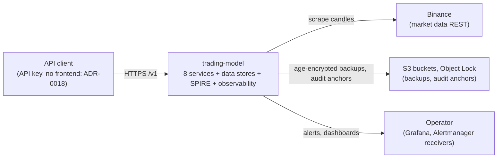
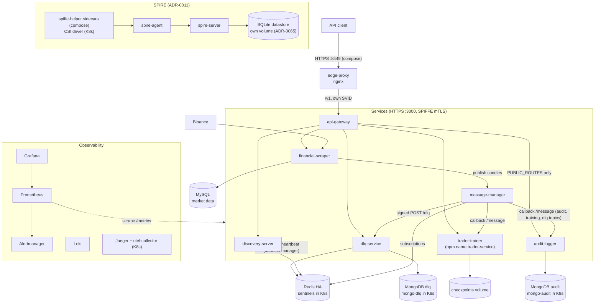
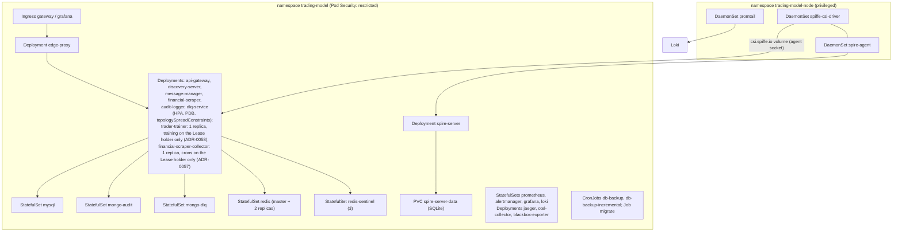
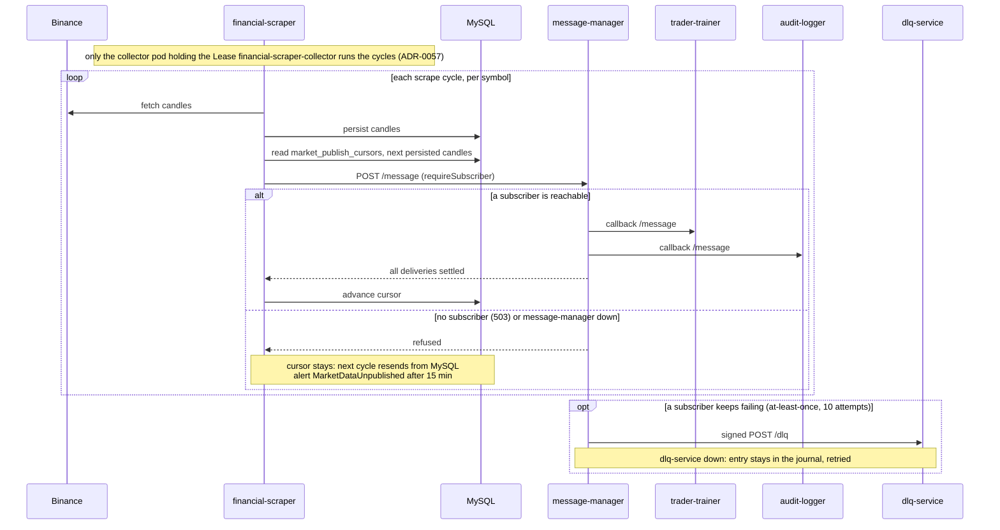

# System Overview (C4)

Four views of the system, each node checkable in `docker-compose.yml`, `deploy/k8s/` or the code. Related: [ADR-0011](../adr/0011-spiffe-spire-workload-identity.md) (SPIRE), [ADR-0048](../adr/0048-durable-message-journal-in-redis-streams.md) (broker), [ADR-0023](../adr/0023-discovery-registry-in-redis.md) (registry), [Databases](databases.md), [Bounded Contexts](bounded-contexts.md).

> **Offline consumer only.** Trained models (`training.model.published`, weights route open to `model-evaluator` alone through `MODEL_DOWNLOAD_CALLERS`) are verified and recorded by the offline `model-evaluator`; collected signals (`GET /financial-scraper/signals/assets/:assetId`) are read by no service. There is no paper-trading or execution context. See [ADR-0049](../adr/0049-downstream-context-for-models-and-signals.md) (Accepted).

## 1. C4 level 1 — Context

## 2. C4 level 2 — Containers

message-manager keeps its subscriptions and a durable message journal (Redis Streams) in Redis (ADR-0048): it has no database of its own. MongoDB belongs to audit-logger and dlq-service. Compose runs one `mongo` container (databases `audit-logger` and `dlq`); K8s runs two StatefulSets, `mongo-audit` and `mongo-dlq`.

## 3. Kubernetes deployment

The restricted namespace forbids `hostPath`, so every host-level agent lives in `trading-model-node` (see `deploy/k8s/node-agents`).

## 4. Market data flow

Each subscribed service gets one delivery per message, whatever its number of instances: message-manager groups the subscribed instances by service and posts to the service name, the Kubernetes Service picks the pod (consumer group, [ADR-0043](../adr/0043-message-delivery-once-per-subscribed-service.md)).

Recoveries: persist-before-publish and the cursor make a bus outage lossless for candles; dead letters can be replayed through `POST /dlq/replay`; an `exactly-once` message relies on audit-logger being idempotent on `messageId`. See [runbook-message-bus-outage](../operations/runbooks/runbook-message-bus-outage.md).
