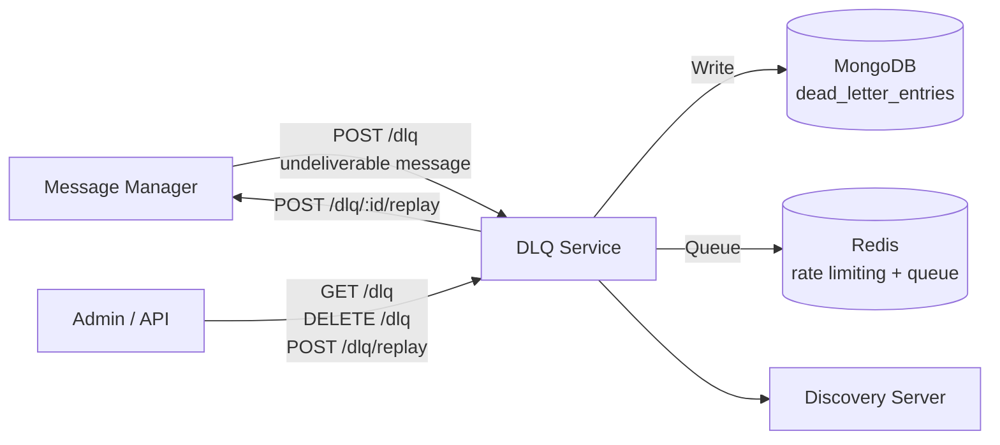

# Architecture — DLQ Service

## Overview

The DLQ Service manages messages that could not be delivered after exhausting retry attempts. It provides durable storage with MongoDB, fast queuing with Redis, and replay capability to re-inject entries into the message bus.

## System Context



## Project Structure

```
services/dlq-service/
├── src/
│   ├── domain/
│   │   ├── dlq-status.ts, dlq-constants.ts
│   │   └── ports/replay.ports.ts   # Claim, release, retry ledger, queue, delivery, audit ports + settings
│   ├── application/
│   │   ├── index.ts      # Bootstrap: MongoDB connect, Redis queue, periodic prune
│   │   ├── server.ts     # Express server factory
│   │   └── services/     # Replay use cases: auto-retry cycle, batch replay, Redis claim replay,
│   │                     # queue rebuild, claim release, replay drain, batch concurrency guard
│   ├── adapters/
│   │   ├── inbound/      # HTTP handlers (add, list, delete, replay, health), routes, auth,
│   │   │                 # rate limiting, Redis queue processor (timer-driven consumer)
│   │   └── outbound/     # MongoDB repository & claim managers, retry manager, delivery executor,
│   │                     # HTTP client, message-manager resolver, audit notifier, Redis pusher
│   ├── infrastructure/   # env, auto-retry scheduler, pruner, Redis init/worker timer, rate-limiter store
│   ├── config/
│   │   ├── container.ts  # Composition root: wires the replay use cases to their adapters
│   │   ├── shutdown-manager.ts # Graceful shutdown: drain replays, release claims, close resources
│   │   ├── address-manager.ts, db.ts, redis-queue.ts, metrics.ts, audit.ts, logger.ts
│   └── shared/           # Types, schemas, shutdown flag, active replay counter, re-export facades
├── tests/
├── Dockerfile
├── package.json
└── tsconfig.json
```

## Key Design Decisions

- **MongoDB persistence** — durable storage for dead letter entries with metadata and payload
- **Redis queue** — fast in-memory queue for pending retries and rate limiting
- **Stale claim release** — on startup, releases any claims orphaned by a previous crash
- **Periodic pruning** — configurable interval removes entries past `ENTRY_TTL_MS`
- **Automatic retry** — optional (disabled by default), automatically re-attempts delivery
- **Degraded mode** — if Redis is unavailable, operations continue (without queue)
- **TLS hot-reload** — on certificate renewal, HTTP client TLS config is reloaded without restart
